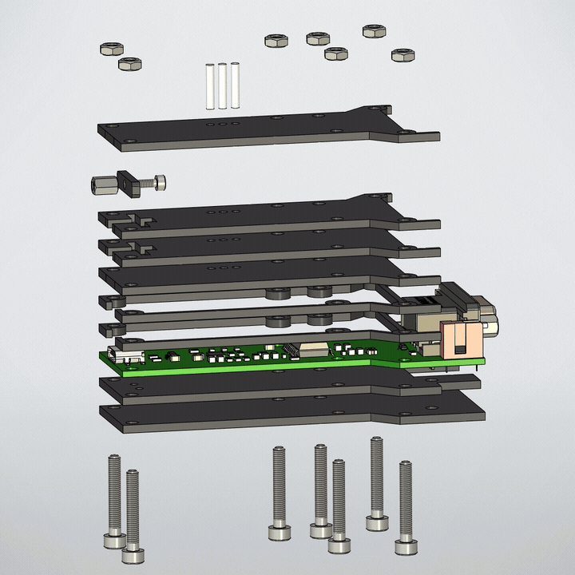

# Корпус USB–RS485

Корпус преобразователя разработан в **T-FLEX CAD**.

Конструкция состоит из плоских деталей из листового ударопрочного полистирола **HIPS толщиной 2 мм**, соединяемых винтами без применения клея.

Использование плоских деталей ориентировано на мелко- и среднесерийное производство: лазерная резка быстрее 3D-печати и дешевле литья при небольших тиражах.

Конструкция оптимизирована под технологию изготовления, поэтому внешний вид корпуса был второстепенным по отношению к простоте и стоимости производства.

Для светодиодной индикации предусмотрены три цилиндрических световода из прозрачного ПММА.

## Анимация сборки

## Исходные файлы

- [CAD](<CAD/>) — модели деталей и крепежа.
- [Assembly.grb](<CAD/Assembly.grb>) — сборка корпуса.
- [STEP](<STEP/>) — каталог экспорта STEP.
- [STL](<STL/>) — каталог экспорта STL.

## Крепёж

| Наименование | Кол-во |
| --- | ---: |
| Винт М3×20, ГОСТ 11738-84 | 7 |
| Гайка М3, ГОСТ ISO 4032 | 7 |
| Стойка М2×6, ГОСТ 20865-81 | 1 |
| Винт М2×5, ГОСТ Р ИСО 4762 | 1 |

## Конструкторская документация

- [Сборочный чертёж корпуса](<../Docs/Сборочный%20чертеж%20XXXX.468352.001%20СБ.pdf>)
- [Чертёж световода](<../Docs/Световод%20цилиндрический%20XXXX.755453.001.pdf>)
- [Чертежи деталей](<../Docs/>)
