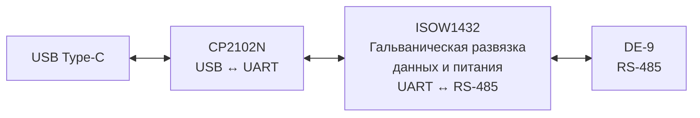

# Преобразователь USB–RS485

Проект преобразователя USB 2.0 ↔ RS-485 с гальванической развязкой и питанием от USB. Предназначен для подключения компьютера к датчикам, контроллерам и другому оборудованию с двухпроводным интерфейсом RS-485, в том числе для наладки и диагностики устройств Modbus RTU/ASCII.

Схемотехника разработана в **Altium Designer** на базе USB–UART-моста **CP2102N-A02-GQFN24** и изолированного приёмопередатчика **ISOW1432DFMR**.

## Статус проекта

Завершён этап разработки печатной платы и корпуса. Подготовлен комплект конструкторской документации на плату и корпус преобразователя.

## Основные характеристики

| Параметр | Требование |
|---|---|
| Подключение к компьютеру | USB 2.0, разъём USB Type-C |
| Представление в ОС | Виртуальный последовательный порт (VCP) |
| Питание | От USB, номинально 5 В |
| Интерфейс линии | RS-485, двухпроводный полудуплекс, A/B и Common |
| Скорость UART | 300–3 000 000 бод |
| Управление направлением | Автоматическое |
| Гальваническая развязка | Информационных цепей и питания |
| Разъём RS-485 | DE-9 female |
| Согласование линии | Отключаемая цепь, механический переключатель |
| Индикация | Питание, TX и RX |
| Целевые ОС | Windows и Linux |

Преобразователь предназначен для прозрачной передачи последовательных данных. Обработка протокола Modbus выполняется программой на компьютере и подключённым оборудованием.

## Структура устройства



Схема разделена на три листа:

- **MAIN** — верхний уровень проекта, подключения и общие цепи.
- **USBtoUART** — преобразование USB в UART.
- **UARTtoRS485** — изолированный интерфейс RS-485.

## Разъём RS-485

Назначение контактов DE-9 по техническому заданию:

| Контакт | Сигнал | Назначение |
|---|---|---|
| 1 | Common | Общий провод изолированной стороны |
| 5 | D1 (B) | Дифференциальная линия D1 |
| 9 | D0 (A) | Дифференциальная линия D0 |
| Остальные | NC | Не используются |

Передача питания через разъём DE-9 не предусмотрена. При подключении следует сверяться с назначением D0/D1 в документации оборудования: обозначения A/B у разных производителей могут различаться.

## Структура репозитория

```text
.
├── Board/                       # Проект платы в Altium Designer
│   ├── SCH/                     # Исходные схемы (.SchDoc)
│   ├── PCB/                     # Исходник печатной платы (.PcbDoc)
│   ├── Drawings/                # Исходники чертежей платы и сборки (.PCBDwf)
│   ├── 3D/                      # Экспорт платы в STEP и DXF
│   ├── Assets/                  # QR-код со ссылкой на репозиторий
│   ├── OutJob/                  # Настройки выпуска документации и файлов
│   └── OUTPUT/                  # Экспорт схем и отчёты Altium
│       ├── КД/                  # Конструкторская документация платы и преобразователя
│       └── Manufacturing/       # Производственные файлы
│           ├── BOM/             # Список компонентов
│           ├── Gerber/          # Gerber-файлы
│           ├── NC Drill/        # Данные сверления
│           └── Pick Place/      # Координаты установки компонентов
├── Case/                        # Проект корпуса
│   ├── CAD/                     # Модели деталей и сборки корпуса (.grb)
│   ├── STEP/                    # Папка для экспорта моделей в STEP
│   └── STL/                     # Папка для экспорта моделей в STL
└── Docs/                        # Чертежи, схемы и спецификации в PDF и XLS
```
