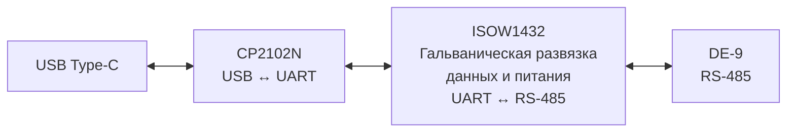

# Преобразователь USB–RS485

Проект преобразователя USB 2.0 ↔ RS-485 с гальванической развязкой и питанием от USB. Предназначен для подключения компьютера к датчикам, контроллерам и другому оборудованию с двухпроводным интерфейсом RS-485, в том числе для наладки и диагностики устройств Modbus RTU/ASCII.

Схемотехника разработана в **Altium Designer** на базе USB–UART-моста **CP2102N-A02-GQFN24** и изолированного приёмопередатчика **ISOW1432DFMR**.

## Статус проекта

Разработка схемотехники. Характеристики приведены по техническому заданию.

## Основные характеристики

| Параметр | Требование |
|---|---|
| Подключение к компьютеру | USB 2.0, разъём USB Type-C |
| Представление в ОС | Виртуальный последовательный порт (VCP) |
| Питание | От USB, номинально 5 В |
| Интерфейс линии | RS-485, двухпроводный полудуплекс, A/B и Common |
| Скорость UART | 300–3 000 000 бод |
| Управление направлением | Автоматическое |
| Гальваническая развязка | Информационных цепей и питания |
| Разъём RS-485 | DE-9 female |
| Согласование линии | Отключаемая цепь, механический переключатель |
| Индикация | Питание, TX и RX |
| Целевые ОС | Windows и Linux |

Преобразователь предназначен для прозрачной передачи последовательных данных. Обработка протокола Modbus выполняется программой на компьютере и подключённым оборудованием.

## Структура устройства

Схема разделена на три листа:

- **MAIN** — верхний уровень проекта, подключения и общие цепи.
- **USB_to_UART** — преобразование USB в UART.
- **UARTtoRS485** — изолированный интерфейс RS-485.

## Разъём RS-485

Назначение контактов DE-9 по техническому заданию:

| Контакт | Сигнал | Назначение |
|---|---|---|
| 1 | Common | Общий провод изолированной стороны |
| 5 | D1 (B) | Дифференциальная линия D1 |
| 9 | D0 (A) | Дифференциальная линия D0 |
| Остальные | NC | Не используются |

Передача питания через разъём DE-9 не предусмотрена. При подключении следует сверяться с назначением D0/D1 в документации оборудования: обозначения A/B у разных производителей могут различаться.

## Содержимое репозитория

| Путь | Содержимое |
|---|---|
| [`USB_to_RS485.PrjPcb`](USB_to_RS485.PrjPcb) | Проект Altium Designer |
| [`SCH/`](SCH/) | Исходные схемы `.SchDoc` |
| [`DOC/USB_RS485_TZ.md`](DOC/USB_RS485_TZ.md) | Техническое задание |
| [`OutJob/Schematics.OutJob`](OutJob/Schematics.OutJob) | Настройки выпуска документации |
| [`OUTPUT/КД/`](OUTPUT/%D0%9A%D0%94/) | Схема Э3 в PDF и перечень элементов ПЭ3 в XLS |
| [`Constraints.xml`](Constraints.xml) | Ограничения проекта |
